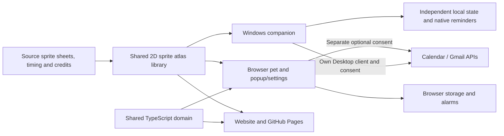

# Mochi

**One GitHub-ready project for an animated 2D sprite companion:** a roaming Windows companion, a Chrome/Edge browser pet, a website, shared character artwork, and the workflows that build them.

Start with **[START-HERE.md](START-HERE.md)**. The complete handoff is **mochi-complete-1.3.0.zip**: extract it and open **Run-Windows/Mochi.exe**, or load the included **Browser-Extension** folder. Source lives at the extracted root and can be pushed as-is; the ready-made folders are ignored by Git.

Website visitors get a real **Download for Windows**. The separate canonical **mochi-project.zip** remains source-only for developers. Dependencies, private credentials, personal runtime data, and Git metadata are excluded from source.

## Choose Mochi's home

| Surface                | What it does                                                                                                                                                       | What must stay running                            |
| ---------------------- | ------------------------------------------------------------------------------------------------------------------------------------------------------------------ | ------------------------------------------------- |
| Windows companion      | A transparent, unboxed companion over desktop applications; roaming, interactions, local and optional Google reminders, real media controls, taskbar/tray recovery | Mochi's native process; the browser may be closed |
| Chrome/Edge extension  | A pet across permitted web pages, popup/settings, local reminders, safe commands, optional Chrome Google connections                                               | The browser                                       |
| Website / GitHub Pages | Character study, interactive demo, project download, installation/privacy/help                                                                                     | Its tab for the demo only                         |

The Windows and browser reminder stores and Google connections are independent. Each runtime can use its own optional Google connection; no token or reminder bridge is implied. A separate optional Tauri scaffold is retained under `apps/desktop`; it is not a macOS/Linux release.

## The character

Mochi offers Eevee and its eight evolutions as animated pixel companions: Eevee, Vaporeon, Jolteon, Flareon, Espeon, Umbreon, Leafeon, Glaceon, and Sylveon. The website, browser overlay, popup/settings previews, and native Windows companion use the same asset library. Playback uses local transparent 2D sprite sheets.

The manifest is authoritative for actions, directions, frame counts, frame rates, loop behavior, and clip durations. The runtime maps idle, walking/running, turn, grooming, stretching, pounce/play/feed, happy, sleep, alert, and carry states to available source animations. Directional walking and running use eight headings. Source sheets, timing XML, credits, and the reproducible atlas builder are included; see [sprite production](docs/art-production.md). Ordinary builds use committed artwork with no artwork download.

The asset checker decodes actual PNG pixels and rejects missing references, wrong dimensions/alpha, empty or opaque-background frames, static walking placeholders, mismatched timing, and incomplete action/skin/direction coverage. Visual acceptance and measured resource use are recorded separately in [release status](docs/release-status.md).

## Repository

```text
START-HERE.md          Friendly setup, GitHub, and runtime choices
apps/
  extension/           Manifest V3 worker, isolated overlay, popup/settings
  windows-companion/   Native Windows WPF application and local reminder engine
  web/                 Website / interactive sprite gallery
  desktop/             Optional unbuilt Tauri cross-platform scaffold
packages/
  shared/              Typed commands, URL safety, time/recurrence, animation logic
  pet-assets/          Source PNG/XML sheets, credits, build tools, manifest and PNG atlases
scripts/               Asset validation, builds, deterministic project/release ZIPs
tests/                 Domain, browser, UI, asset, and packaging regression tests
.github/workflows/     Browser CI, native CI, Pages deployment, version-tag releases
docs/                  Art, privacy, Google, setup, deployment, verification
```



## Let GitHub build it

Create an empty repository in your own account. From the extracted project directory, replace the example URL and run:

```sh
git init
git add .
git commit -m "Build Mochi companion"
git branch -M main
git remote add origin https://github.com/YOUR_ACCOUNT/mochi.git
git push -u origin main
```

GitHub Desktop can publish the folder instead. If a remote already exists, use `git remote set-url origin ...` rather than adding it twice. The project ZIP intentionally contains no `.git` directory and makes no claim that a remote repository already exists.

The **Verify Mochi** workflow checks source/browser builds. **Release Mochi** builds Windows first, transfers that exact artifact into packaging, verifies outputs, and publishes runnable assets on default-branch pushes, version tags, or explicit dispatch. No manual release tag is needed for the first runnable download. Only publication has repository write access.

Existing lightweight/annotated tags are resolved to commits. A version is reused only for identical source. If v1.3.0 already names different source, a distinct v1.3.0-build.RUN_NUMBER release is published instead of replacing another commit’s binaries.

## Publish the website through Actions

A repository owner must select **Settings → Pages → Source → GitHub Actions** once. GitHub’s built-in token cannot create a new Pages site; this project does not require a personal token. Then run Deploy demo to GitHub Pages or push a default-branch change.

Pages builds Windows first and includes its actual ZIP in website downloads. The generated manifest supplies available files and checksums. If local downloads are absent, the website checks a configured public repository’s latest Release and offers the native link only when that asset exists. Otherwise it shows an explicit unavailable message. It never labels source code as a runnable app.

Actions supplies the public repository automatically. For another host, set MOCHI_REPOSITORY=OWNER/REPOSITORY and copy the complete apps/web/dist folder. Pages uses its real metadata base path. Without Pages setup, artifacts still build and deployment is skipped with a clear owner instruction.

## Run the Windows companion

Open **Run-Windows/Mochi.exe** in the complete handoff, or extract the website’s native download and keep **Mochi.exe**, its configuration, and the **assets** folder together, and open the executable. Windows 10/11 with .NET Framework 4.8 is the target. The portable application has no mandatory account or installer.

Click/right-click the companion for interactions, commands, reminders, and settings; drag to carry it. Recall it through the normal taskbar/tray entry or available `Ctrl+Alt+M` shortcut. Hide keeps enabled local reminders running; pause rests the pet; Quit stops the process and reminder delivery. Start at Windows sign-in is an explicit opt-in setting.

Native reminders can notify with every browser closed **while Mochi remains running and Windows is awake**. Optional native Calendar/Gmail monitoring uses your own Desktop OAuth client and runs independently of Chrome. Music controls use actual Windows media sessions; no browser bridge is required. Read [Windows setup and limitations](docs/windows-companion.md).

To compile locally on Windows:

```powershell
powershell -NoProfile -File scripts/build-windows.ps1
```

The default native script compiles, runs its checks, and packages the executable together with the included sprite assets. Browser builds do not require Windows, WPF, Rust, or the optional Tauri prerequisites.

## Install the browser extension

Extract the built `mochi-chrome-extension.zip` into a permanent folder. In `chrome://extensions` or `edge://extensions`, enable Developer mode, choose **Load unpacked**, and select the folder directly containing `manifest.json`. Pin Mochi and refresh a normal HTTP/HTTPS page.

The browser pet roams through the viewport rather than staying inside a demo panel. Drag it, pet/feed/play, choose companion/size/opacity, and adjust wandering/following, sound, quiet hours, and reminder preferences. Choose **Settings** on the pet to open the full extension options page. The popup's **Call Mochi**, command `come here`, or available `Alt+Shift+C` shortcut recalls it. `Alt+Shift+M` toggles visibility and `Alt+Shift+Q` shuts down Mochi services when those keys are available. Actual disabling/removal uses the browser's extension manager.

Browser internal pages, extension stores, and other protected pages can refuse content scripts. No bypass is attempted. Keep the extracted build folder while the unpacked extension is installed.

## Local browser / website development

Prerequisites: Node.js 24+ and npm 11+. Dependencies are pinned by `package-lock.json`.

```sh
npm ci
npm run validate:assets
npm run typecheck
npm test
npm run lint
npm run build
npm run validate:manifest
npm run package
npm run verify:release
```

`npm run check` runs the complete browser/site/release sequence. Use `npm run format` while editing. `npm run dev` starts the website at the printed local URL. Load `apps/extension/dist` through Load unpacked after building; rebuild/reload the extension and refresh web tabs after source changes.

Restricted Windows hosts may refuse workspace links; use `npm ci --workspaces=false` there. Vite, Vitest, and TypeScript resolve shared source aliases. Do not set `workspaces=false` globally, because it conflicts with explicit `npm --workspace` run commands. npm is the canonical lockfile workflow; the retained pnpm workspace can run root script aliases after npm installs the pinned dependencies. Do not generate a conflicting second lockfile.

A clean install from an initial archived snapshot installed 191 packages and passed typecheck, 131 tests in five files, and production builds. That historical check predates the later roaming and sprite-family changes; final snapshot checks are separately recorded in [release status](docs/release-status.md).

## Unified project and build outputs

```sh
npm run package:project
npm run verify:project
```

These produce and verify the primary **`dist/mochi-project.zip`** directly from project source, including source sheets, artist credits, animation timing, and every runtime's source/setup. This source ZIP can be pushed to GitHub after extraction. It excludes generated builds, duplicated web asset copies, dependencies, caches, private environments, user state, and repository metadata.

`npm run package` additionally creates internal browser/website packages after builds and includes an existing valid native ZIP in checksums. The website's generated downloads are separate from its lean compiled archive, avoiding circular or repeatedly nested project ZIPs. `dist/SHA256SUMS.txt` describes actual built artifacts. No native installer is fabricated on Linux or when the native toolchain/assets are unavailable.

## Commands, reminders, and music

Browser examples:

```text
open GitHub
play Mercy by Shawn Mendes
search YouTube for Mercy full song
remind me in 10 minutes to join the meeting
remind me tomorrow at 9 AM to call Alex
show my next event
check email
come here
pause the pet
resume the pet
stop following my cursor
help
```

The deterministic parser separates intent from execution, validates messages/imports/HTTP/HTTPS destinations, and asks for clarification when needed. It never treats page, email, or calendar content as instructions and never runs arbitrary code. Native commands support their documented local-reminder/website subset.

Song searches open YouTube so you can choose a recording. The installed browser pet has a separate, on-demand media bridge for standard audio/video elements in supported tabs: play/pause, seeking, volume and looping, plus next/previous when supported YouTube/Spotify controls are available. The bridge runs in eligible frames without adding another pet, reports actual player state, and reports refusal instead of claiming success. Protected players, autoplay restrictions and site changes can limit control. The Windows app uses actual Windows media sessions, with a player chooser and enabled Play/Pause/Next/Previous/Stop controls. It does not inject media keys or require the extension. The bundled local demo player is separate from your external media.

Local reminders support one-time, daily, and weekly schedules, timezone-aware recurrence, snooze/dismissal, pause, and durable occurrence claims. Browser alarms are reconstructed after startup and use bounded scheduling/sweeps; native schedules use the running Windows process. Claims favor at-most-once delivery: a crash or OS refusal after persistence can miss an alert rather than duplicate it. Sleep/closed-runtime behavior is not an uninterrupted-delivery guarantee. See [behavior and limits](docs/behavior-and-limits.md).

## Reminders with links

```text
remind me in 10 min to check mail
remind me in 20 min to check https://example.com
remind me in 30 sec to stretch
```

`min`, `mins`, `m`, `sec`, `secs`, `s`, `hr`, `hrs`, `h`, `d`, `wk`, and `wks` are supported alongside full unit names; spaces such as `in 20 min` and `in20min` are accepted. A normal reminder requests an OS notification and keeps a readable dialogue near the returned pet. Enable reminder delivery and send a test notification first.

An explicit local reminder containing one validated HTTP/HTTPS URL can request opening that link when due. The installed native companion launches the default browser; the extension opens a browser tab. The runtime must be running and awake. The URL stays in the reminder so **Open link** remains available. Snoozing preserves that URL and does not repeat the automatic opening; imported backups and Google Calendar links do not silently enable automatic opening.

The website demo can only attempt a timed new tab. Browsers may block it: a clear blocked message and **Open saved link** remain in its reminder dialogue. Its timers require the demo tab to stay open. Opening a page does not guarantee a network connection, playback, or an automatic song selection.

## Google connections with your own project

The public build has no configured Google API client, shared publisher Cloud project, or backend. Reviewed web shortcuts open your signed-in Gmail/Calendar pages immediately; you finish Send/Save in Google. Optional read-only monitoring uses **your own project and quotas**.

| Runtime           | Personal setup                                                                                                                                  | What must stay running                  |
| ----------------- | ----------------------------------------------------------------------------------------------------------------------------------------------- | --------------------------------------- |
| Windows companion | Open Google connections, save your own **Desktop app** OAuth client ID locally, then connect Calendar and/or Gmail                              | Mochi and Windows; Chrome can be closed |
| Chrome extension  | Prepare a personal copy with `scripts/setup-personal-google.ps1`, using a **Chrome Extension** OAuth client for the supplied fixed extension ID | Chrome and the enabled extension        |

The two client types are not interchangeable. A Desktop client may require its optional secret in the masked local field; keep it on your PC. Never paste passwords, secrets, tokens, or credentials JSON into chat, logs, source, or a public download. Native Google configuration and the entire private cache use Windows DPAPI for the current user under `%LOCALAPPDATA%\Mochi\Google`. Public archives contain none of this runtime configuration. See [Google setup](docs/google-setup.md) for both paths and the personal Chrome build alternative.

In 1.3, **All new inbox mail** is the default. Important and Senders only remain explicit filters. The connection screen shows the active filter, sync/delivery status and queued alerts. The first successful Gmail check establishes a silent baseline; later eligible arrivals request an OS notification and remain as readable cards until acknowledged. Quiet hours, mute and pause can defer delivery. Chrome checks normally every minute; native checks offer 1, 5 or 15 minutes, with backoff on errors.

Calendar uses a rolling **30-day** snapshot. Timed events become local reminders; all-day reminders are enabled by default at **9 AM**, with settings to change this. Successfully cached native events can notify with every browser closed while Mochi stays running and Windows awake. Refresh is needed to learn later event changes. Notifications use generic labels; event titles/descriptions and mail subjects/bodies are not fetched. The scopes are `calendar.events.readonly` and `gmail.metadata`; neither connection sends mail or edits events. Google Tasks is not connected.

Send a test notification, check the last successful refresh, and confirm the intended filter before relying on alerts. Google and the OS can defer or refuse service/display. Live account and delivery acceptance is recorded in [release status](docs/release-status.md); implementation and automated tests alone do not establish it. Google quotas and GitHub hosting/download limits still apply.

## Privacy, shutdown, and deletion

The default experience is local-first, with no telemetry, mandatory server/account, remote executable code, or external AI service. HTTP/HTTPS content-script access draws the browser overlay; it is not used to collect browsing history or inspect unrelated page content. Optional Google requests contact official APIs after consent. Read [privacy](docs/privacy.md) and [security](SECURITY.md).

Browser preferences/reminders/positions/recent commands/diagnostics and optional summaries use extension local storage. Browser export files may contain personal text and exclude Google tokens. Native preferences/reminders live separately in `%LOCALAPPDATA%\Mochi\state.json`; this ordinary state and browser storage are not encrypted vaults. Native Google credentials/cache are separately DPAPI-protected for the current Windows user. Quit before backing up/deleting native data. Encryption does not protect against code running as the same user or a compromised PC.

Disconnect Google services and revoke Google account-side access when needed; reset browser data or remove the extension separately. Disable native start-at-sign-in before deleting its portable folder, quit the process, and delete native data separately if desired. Pause/hide preserve state; shutdown/quit stop the selected runtime's work. No unrelated data is removed silently.

## Release boundaries

Native Windows, installed-extension behavior, real OS notifications, mixed-DPI/full-screen/lock-resume conditions, live Google consent, browser-store review, and actual remote Actions/Pages deployment have distinct verification boundaries. Consult the [recorded results](docs/release-status.md) and [manual checklist](docs/manual-verification.md); test files or supplied workflows alone are not a passing result.

Mochi code and original bundled demo audio are MIT licensed. This is a noncommercial fan project. Pokémon characters and SpriteCollab artwork are separate third-party material under the supplied source terms, including Attribution-NonCommercial 4.0; the code license does not relicense them. Preserve the supplied source credits, attribution records, and usage terms when redistributing. A public distributor must supply a real privacy/security contact and complete the relevant store/Google verification.
